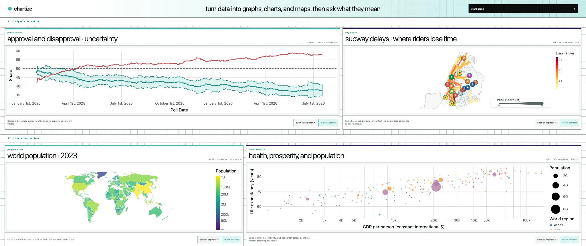

# Chartize

**Turn a question into an inspectable, presentation-ready data story—without sending the working dataset to a server.**

Chartize is a self-hosted, local-first visualization studio for exploring public or private data with GGSQL, browser-local SQL, and GPT-6 Luna. It keeps code, source rows, rendered charts, selected marks, and AI discussion in one workspace, so every suggestion can be inspected against the data and executed where the data lives: in the browser.



## How Codex built Chartize

Chartize was designed and implemented end to end in one long-running Codex collaboration powered by `gpt-5.6-sol` at maximum reasoning. The primary build session spanned July 16–21, 2026 and contains more than 250 rounds of product direction, implementation, visual review, and verification. I supplied the product goals, data-story ideas, design judgment, and course corrections; Codex worked directly in the repository to research the problem, propose and challenge technical approaches, write the application, run it, inspect failures, and revise the result.

This was not a one-shot scaffold. The working product emerged through a repeated build-observe-correct loop:

- Codex researched the hackathon, GGSQL, browser data engines, public datasets, and the relevant OpenAI APIs, then turned that research into an implementation plan and working vertical slices.
- It built the Next.js/React workspace, Monaco editing experience, Zustand/Zod state model, visualization controls, dataset pipeline, Chartize AI tool loop, example gallery, responsive layouts, tests, documentation, and VPS deployment configuration.
- It used a real Chrome session throughout development to click through the product, exercise Chartize AI, inspect charts and browser diagnostics, compare screenshots at laptop and mobile widths, and reproduce interaction bugs rather than treating compilation as proof that the experience worked.
- It ran type checks, unit and browser acceptance tests, production builds, and code-quality audits, then committed the work in focused checkpoints and helped package the standalone Next.js build for PM2 and Nginx.

The conversation also drove major architectural decisions. Chartize began with a separate Rust data service, but browser testing and a security review exposed a cleaner boundary: GGSQL and SQL should execute inside a Web Worker, Dexie/IndexedDB should own local datasets and workspace isolation, and the server should expose only fixed catalog and exact-version artifact reads. Codex carried that pivot through the application, tests, data artifacts, and documentation. The same process shaped the DWIM-inspired contextual interface, explicit authorization for local AI mutations, one independent AI conversation per workspace, static homepage previews, and the selection model shared by maps and ordinary charts.

The original build used GPT-5.6 in two distinct roles: `gpt-5.6-sol` powered the Codex agent that developed and verified the project, while `gpt-5.6-luna` powered the in-product assistant. Chartize AI now defaults to `gpt-6-luna`.

## How GPT-6 Luna powers Chartize

Chartize uses `gpt-6-luna` through the OpenAI Responses API as a workspace agent. Each turn is structured and Zod-validated. A DWIM context resolver runs at send time, so the model receives the live code cursor, chart range, selected marks, table cells, or whole workspace that the user is actually addressing. It distinguishes edited or failed GGSQL from the last query that successfully produced the visible chart. Selected row values initially stay in the browser; the agent sees only column names and a count. When a question needs those values, it requests bounded results. Genuinely ambiguous permission gets a short question first.

| Job | Luna's role | How Chartize keeps it grounded |
| --- | --- | --- |
| Discuss data and code | Explain the current query, rendered result, selected marks, table cells, or a proposed analysis while preserving one conversation across every workspace pane | Source IDs, typed schemas, current and last-rendered code, chart metadata, and bounded selection context accompany the turn; earlier user messages retain their former DWIM referent |
| Answer with exact values | Decide which concrete values are needed and emit one to four bounded data requests | Rendered-chart questions can query `rendered_data`, which wraps the exact last-rendered SELECT with its joins and filters. Source-table questions use workspace scope. The browser runs the SQL and returns bounded results to the same Responses conversation, for at most three data rounds |
| Enhance a visualization | Return structured, non-mutating GGSQL and an explanation, then perform a presentation-quality pass over color, axes, domains, legends, labels, and uncertainty | A local digest of the official GGSQL 0.4.1 documentation and tested drawing recipes is available as an agent tool; the candidate runs in the browser before it is accepted |
| Repair generated code | Diagnose the exact engine failure and make the smallest documented correction | Chartize feeds the failed candidate and browser diagnostic back for up to two focused repair attempts |
| Ground outside claims | Use Wikipedia search and article retrieval for established background; use web search for current news, primary sources, or gaps Wikipedia cannot fill | Articles carry source links; one paid web-search pass is allowed per turn, including browser-data continuations |

The answering model chooses its own tools; there is no separate planning model call, keyword switch, or response-personality checklist. Independent reference calls run in parallel. Wikipedia and the local GGSQL reference are available immediately. When current information, a requested primary document, or a gap in Wikipedia warrants paid web research, Luna enables it itself. The chat streams actual search topics, article titles, data-query purposes and rendering steps into a live activity indicator; the reply's activity details show which tools it used. Browser SQL stays sequential because it operates on a shared workspace engine.

Thinking defaults to **auto**, starting at medium and allowing Luna to increase effort for harder analysis or code. Manual **low / medium / high / xhigh / max** choices beside Send stay fixed. API Fast mode stays on for GPT-6 and GPT-5.6 model overrides. Direct OpenAI calls use `store: false`. Luna receives one stable developer prefix with an explicit 30-minute cache breakpoint; workspace state, preferences, and permissions follow after that boundary. Tool definitions stay stable while per-turn `allowed_tools` controls which research and workspace tools are callable. Chartize deliberately keeps completed conversation state in the browser instead of creating a provider-hosted conversation. During a single multi-step turn, encrypted reasoning and function-call items are replayed with the official SDK so the model can continue its analysis without discarding its working state. Only an opaque, account-bound continuation ID goes to the browser; suspended turns expire after ten minutes or a server restart. The server never exposes its OpenAI key to the browser and never executes model-authored SQL. Persistent browser-local mutations require an explicit user request and are separated from the visualization query.

Wikipedia calls the English MediaWiki API and has no OpenAI per-search fee; retrieved text still contributes input tokens. Search returns matching titles and a bounded excerpt of the top article together, often avoiding another model round just to open it. Article retrieval provides other pages or later passages. Request starts are rate-limited while independent reads can overlap. There is no persistent article cache.

For opt-in, paid behavior checks, run `pnpm --filter @chartize/web eval:ai evals/agent.eval.ts` with the local app running. Set `CHARTIZE_EVAL_CASE=mta` to run just the subway question and follow-up. `CHARTIZE_EVAL_MODEL=gpt-6-luna` selects a model independently of local settings; `CHARTIZE_EVAL_RUN=baseline-1` labels a comparison run. `evals/research.eval.ts` retains the original GPT-5.6 prompt-free baseline and source-guidance variants. Reports under ignored `data/evals/` record answers, tool choices, timing, and token use for manual review. These evaluations use real API quota; the normal test suite uses mocks and does not.

The [GPT-6 Luna evaluation](./docs/GPT6_LUNA_EVALUATION.md) records the model comparison, token-cost estimates, Chrome checks, fixes, and remaining limitations.

## The workspace

The explorer is the product surface. Monaco GGSQL stays primary while sources, fields, visualization parameters, table ranges, chart ranges, and map features expose contextual controls around the current selection. On desktop, the code, source table, and rendered result live in three resizable panes; tablet and phone layouts turn them into graph-first tabs with a persistent Chartize AI entry beneath the visualization. Clicked marks, Shift-click multi-selections, and dragged ranges share one height-bounded, scrollable inspector. Ranges persist with editable corner handles, a compact range label, intersecting-mark count, zoom, copy, CSV export, and Chartize AI handoff.


## Local-first execution

| Input | Storage | Execution |
| --- | --- | --- |
| Published datasets | Canonical, versioned Parquet on the VPS; exact artifact bytes retained by worker-owned Dexie/IndexedDB | `ggsql-wasm` in a Web Worker |
| Visitor CSV, TSV, JSON/NDJSON, Parquet, GeoJSON, or zipped Shapefile | Worker-owned Dexie/IndexedDB, private to this browser | The same browser worker |
| Derived tables and mutations | An isolated, mutable engine context for each workspace | The same browser worker |
| AI visualization or analysis request | One conversation per workspace; schema and enabled context are relayed to the model | Any requested data query runs in the browser, then its bounded result returns to the AI relay |

React and Zustand do not know that IndexedDB or the data service exists. They send typed commands to one browser worker. When GGSQL first references `chartize:<slug>`, that worker resolves the catalog version, checks Dexie, downloads the exact Parquet artifact only when missing, stores it, and registers a copy in the active workspace's engine context. Subsequent workspaces and sessions reuse the canonical bytes locally. A workspace may freely create, update, rename, or derive local tables without changing that baseline or another workspace.

Next.js exposes a deliberately small data surface on the same origin: catalog metadata, exact dataset-version downloads, and steward-only ingestion and rollback. It never accepts arbitrary SQL from the browser or from Chartize AI.

The same boundary applies to Chartize AI: the model can request bounded workspace data, but the browser worker remains the only component that can execute it. The full agent and repair loop is described above.

## Included examples

The example menu currently contains 23 browser-tested views: polling lines and uncertainty bands; county population, health, income, and GDP maps; descriptive regressions and scenarios; MTA route-delay, route-by-month, and station-accessibility views; NOAA daily and seasonal temperature views; worldwide population, development, climate, and food views; and a USDA equal-area land-use atlas shaped like the contiguous United States. The transit map uses official MTA route colors and endpoint badges, with a tapered in-scene key that explains how rider volume controls line width. Signed change maps consistently use red for decline, yellow near zero, and green for growth.

## Stack

- Next.js 16, React 19, Monaco, Vega/Vega-Lite, Vanilla Extract
- Zod-validated Zustand workspace documents and actions
- `ggsql-wasm` plus an in-browser SQL engine in a Web Worker
- Dexie/IndexedDB, owned only by the worker, for canonical Parquet bytes, local uploads, catalog metadata, and saved workspace documents
- Explicit Next.js Node routes for catalog, exact Parquet delivery, steward imports, and rollback
- DuckDB Node Neo for server-side ingestion/catalog metadata; normalized published datasets are Parquet
- OpenAI Responses API with latency-first `gpt-6-luna`
- Node 24, PM2 and Nginx on one VPS; ATProto OAuth for chat, with private SQLite sessions

`ggsql-wasm` stays pinned to 0.4.1: the 0.5 series replaces Vega-Lite output with a different SVG renderer. Upgrading it requires a separate migration of Chartize's canvas rendering, mark selection, and chart controls.

## Run locally

Requirements: Node 24+ and pnpm 10+.

```bash
cp .env.example .env.local
pnpm install
pnpm fetch:spatialite
ADMIN_TOKEN=local-dev-token pnpm dev
```

Open `http://localhost:3000/explore`. The catalog and artifact routes are served by the same Next.js process. `/admin` uses your signed-in account's database-backed admin role; the optional `ADMIN_TOKEN` above is for the dataset-seeding script.

In a second terminal, publish the starter datasets:

```bash
ADMIN_TOKEN=local-dev-token pnpm data:seed
```

The embedded penguins table is an engine smoke test, not a published dataset. The acquisition list and refresh notes are in [`datasets/README.md`](./datasets/README.md).

For AI, set `OPENAI_API_KEY` in the environment used by Next.js. The key remains server-side. Open the AI panel and choose **Log in with Bluesky** to continue through ATProto OAuth. The rest of the studio works without signing in. Questions that need row values may send bounded results to the model; uploads themselves are not sent to the VPS.

## Chat sign-in and hosting

Chat uses the official ATProto Node OAuth client with the identity-only `atproto` scope. It verifies the account DID and creates a seven-day HttpOnly session; Chartize does not request posting permissions or retain provider tokens after sign-in. The login window leaves your workspace and unsent prompt in the original tab. Signing out does not clear local workspaces.

The profile menu in the homepage and explorer header contains sign-in, sign-out and system/light/dark appearance. Each account DID has its own browser-local workspace collection, chat histories, uploaded data and theme preference. Signing in from an anonymous workspace carries the active chart, its referenced uploads, conversation and unsent prompt into the account, alongside any work already saved there. The anonymous copy remains available after signing out. Public Parquet downloads are shared across profiles. These profiles are local to the browser, with no cloud workspace sync.

Locally, the default origin is `http://localhost:3000`; the provider callback uses `http://127.0.0.1:3000/api/auth/callback`, as required by ATProto loopback OAuth. The original tab completes sign-in using a browser-bound secret, so switching callback hostnames does not move your IndexedDB data.

For the VPS, set `CHARTIZE_PUBLIC_URL=https://chartize.dileepreddy.com` and keep the app on loopback behind Nginx. Public OAuth metadata is served at `/api/auth/client-metadata.json` and `/api/auth/jwks.json`; these URLs must not be blocked by Basic Auth or a Cloudflare challenge. A signing key is generated in the private auth database on first use. No developer-portal registration or manually copied client secret is needed.

The AI endpoint checks the session, same-origin requests, bounded request size and usage limits. Defaults are 50 new turns per account per UTC day, 300 across the site, one active request per account and four across this single app process. Continuations do not spend another daily turn. Set `CHARTIZE_AI_USER_DAILY_TURNS` and `CHARTIZE_AI_DAILY_TURNS` to adjust the daily limits (zero disables new turns). These are practical usage controls, not a dollar-denominated spending cap; also set a budget in your OpenAI project.

Use one PM2 instance. Follow [the VPS notes](./docs/VPS_DEPLOYMENT.md) for standalone files and public browsing / authenticated chat. The checked-in Nginx configuration delegates admin access to the app's role checks. **Deploy the app, grant the admin role, and verify access before removing the live Nginx Basic Auth wall.**

### Admin accounts

The private SQLite database has an `admin_accounts` table keyed by `(provider, subject)`. For ATProto, the subject is the verified DID. The profile menu shows an **admin** button for members; the page, Server Actions, and browser import/rollback requests each check current membership. Changes apply to existing sessions, and handles can change without affecting access.

After your first login initializes the database, replace `<YOUR_ATPROTO_DID>` with your account's verified DID to grant admin access:

```bash
sqlite3 data/auth/sessions.sqlite "INSERT INTO admin_accounts (provider, subject) VALUES ('atproto', '<YOUR_ATPROTO_DID>') ON CONFLICT DO NOTHING;"
```

Use the configured auth directory if `CHARTIZE_AUTH_DIR` differs. Additional administrators get their own rows. Delete a row to revoke access; restarting the app does not recreate grants. Keep this table private alongside sessions. A configured `ADMIN_TOKEN` remains an independent credential for command-line dataset seeding, never a profile/admin-page login.

The storage layout fits a single 70 GB VPS:

```text
data/
  chartize.duckdb
  auth/sessions.sqlite  # private login state, signing key, sessions, admin roles and usage counters
  datasets/<slug>/<version>/
    <original upload>
    data.parquet
```

Back up `data/` as one unit, keeping the auth directory private. `CHARTIZE_AUTH_DIR` can place authentication state elsewhere. Imports retain the original, normalize a canonical version to Parquet, profile it, and atomically activate that version. Rollback reactivates the previous version without deleting either copy. These published files are baselines; browser workspaces remain independently mutable.

## Security boundary

- Public browser code can request only a catalog entry or an exact `{slug, version}` Parquet artifact.
- The server never executes visitor/model SQL or GGSQL. The AI relay sees code as context; data routes accept only fixed catalog and exact-version artifact reads.
- SQL and GGSQL execute in the browser worker; local derived tables and mutations cannot modify VPS data.
- Only the worker can access Dexie or request catalog/data artifacts. React and Zustand cannot issue data-service requests.
- The browser worker has a 100 MB per-file import guard; steward import limits are configured separately.
- AI calls use `store: false`. Selected samples are omitted until needed for the question or specifically approved; data queries run under the browser engine's read-only guard.
- Chat requires ATProto login. OAuth discovery uses SSRF-protected fetches, and provider/session secrets are never exposed in JSON or local workspace storage.
- The admin console requires an explicit database admin grant for the verified ATProto DID. Browser imports and rollbacks use that session; the dataset-seeding script can use a separately configured `x-admin-token`.

## Verification

```bash
pnpm --filter @chartize/web typecheck
pnpm --filter @chartize/web test
pnpm --filter @chartize/web build
```

The browser acceptance pass covers cold and warm `chartize:` loads, workspace mutation isolation, workspace teardown, and a local CSV upload that Chartize AI can clean into a derived table before source deletion resets that workspace. The CSV path performs no catalog or dataset-artifact request. The bundled example suite is also exercised in Chrome: every example must load and render a nonempty result without a UI diagnostic. Direct map clicks, ordinary point clicks, multi-selection, and persistent rectangular selections are checked through the same visible interaction layer used by a person.

The post-pivot boundary review is in [`docs/CODE_AUDIT.md`](./docs/CODE_AUDIT.md).
