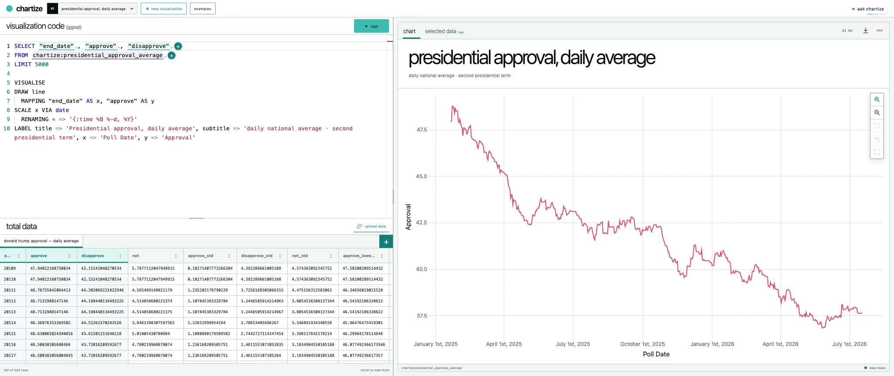
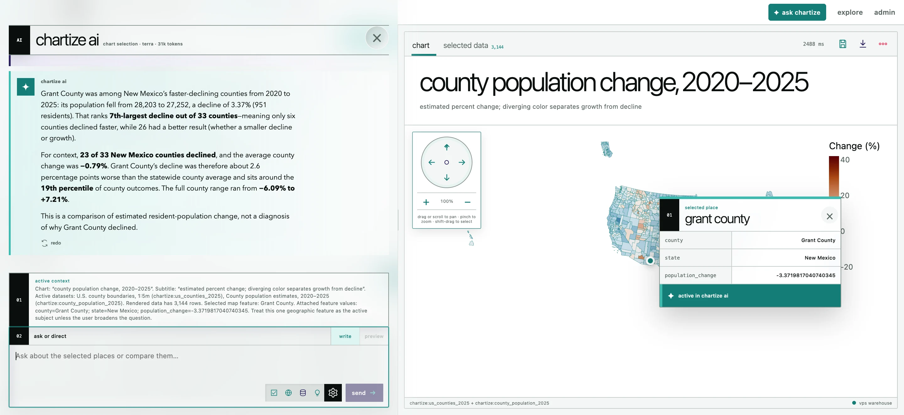

# Chartize

Chartize is a self-hosted, local-first GGSQL visualization studio for civic, polling, Census, election, economic, and geographic data.

The explorer is the product surface. Monaco GGSQL stays primary while sources, fields, visualization parameters, table ranges, chart ranges, and map features expose contextual controls around the current selection. The code, source table, and rendered result live in three resizable panes.



## Local-first execution

| Input | Storage | Execution |
| --- | --- | --- |
| Published datasets | Canonical, versioned Parquet on the VPS; exact artifact bytes retained by worker-owned Dexie/IndexedDB | `ggsql-wasm` in a Web Worker |
| Visitor CSV, TSV, JSON/NDJSON, Parquet, GeoJSON, or zipped Shapefile | Worker-owned Dexie/IndexedDB, private to this browser | The same browser worker |
| Derived tables and mutations | An isolated, mutable engine context for each workspace | The same browser worker |
| AI visualization or analysis request | One conversation per workspace; schema and enabled context are relayed to the model | Any requested data query runs in the browser, then its bounded result returns to the AI relay |

React and Zustand do not know that IndexedDB or the data service exists. They send typed commands to one browser worker. When GGSQL first references `chartize:<slug>`, that worker resolves the catalog version, checks Dexie, downloads the exact Parquet artifact only when missing, stores it, and registers a copy in the active workspace's engine context. Subsequent workspaces and sessions reuse the canonical bytes locally. A workspace may freely create, update, rename, or derive local tables without changing that baseline or another workspace.

Next.js exposes a deliberately small data surface on the same origin: catalog metadata, exact dataset-version downloads, and steward-only ingestion and rollback. It never accepts arbitrary SQL from the browser or from Chartize AI.

Chartize AI is one workspace-scoped, latency-first Luna conversation. It receives the active query, chart description, catalog schemas, user-enabled selection context, and unresolved browser diagnostics. If it needs exact values, it emits a bounded data request; the worker runs it in the same workspace engine and continues the model turn. Generated GGSQL is tried locally, and an engine diagnostic—including the exact failed candidate—can trigger up to two bounded repair passes. A compact local digest of the official GGSQL 0.4.1 documentation and drawing recipes is available to the agent, so ordinary syntax generation does not require a web search.



## Included examples

The example menu currently contains 18 browser-tested views: polling lines and uncertainty bands; county population, health, income, and GDP maps; descriptive regressions and scenarios; MTA route-delay, route-by-month, and station-accessibility views; NOAA daily and seasonal temperature views; and a USDA 100-square land-use composition. The transit maps use official MTA line/station geometry and NYC borough boundaries, while signed change maps consistently use red for decline, yellow near zero, and green for growth.

## Stack

- Next.js 16, React 19, Monaco, Vega/Vega-Lite, Vanilla Extract
- Zod-validated Zustand workspace documents and actions
- `ggsql-wasm` plus an in-browser SQL engine in a Web Worker
- Dexie/IndexedDB, owned only by the worker, for canonical Parquet bytes, local uploads, catalog metadata, and saved workspace documents
- Explicit Next.js Node routes for catalog, exact Parquet delivery, steward imports, and rollback
- DuckDB Node Neo for server-side ingestion/catalog metadata; normalized published datasets are Parquet
- OpenAI Responses API with latency-first `gpt-5.6-luna`
- Docker Compose with Caddy, or host Nginx with Basic Auth, on one VPS

## Run locally

Requirements: Node 24+ and pnpm 10+.

```bash
cp .env.example apps/web/.env.local
pnpm install
pnpm fetch:spatialite
ADMIN_TOKEN=local-dev-token pnpm dev
```

Open `http://localhost:3000/explore`. The catalog and artifact routes are served by the same Next.js process; use `local-dev-token` on `/admin`.

In a second terminal, publish the starter datasets:

```bash
ADMIN_TOKEN=local-dev-token pnpm data:seed
```

The embedded penguins table is an engine smoke test, not a published dataset. The acquisition list and refresh notes are in [`datasets/README.md`](./datasets/README.md).

For AI, set `OPENAI_API_KEY` in the environment used by Next.js. The key remains server-side. The browser receives only the structured AI result; the AI route receives bounded browser query results only when the enabled data-access option permits them.

## VPS preview

```bash
cp .env.example .env
# Set a long ADMIN_TOKEN, SITE_ADDRESS, and OPENAI_API_KEY.
docker compose up --build -d
```

Set `SITE_ADDRESS=studio.example.com` for Caddy-managed HTTPS. For host Nginx and Basic Auth, follow [`docs/VPS_DEPLOYMENT.md`](./docs/VPS_DEPLOYMENT.md).

The storage layout fits a single 70 GB VPS:

```text
data/
  chartize.duckdb
  datasets/<slug>/<version>/
    <original upload>
    data.parquet
```

Back up `data/` as one unit. Imports retain the original, normalize a canonical version to Parquet, profile it, and atomically activate that version. Rollback reactivates the previous version without deleting either copy. These published files are baselines; browser workspaces remain independently mutable.

## Security boundary

- Public browser code can request only a catalog entry or an exact `{slug, version}` Parquet artifact.
- No server route accepts SQL or GGSQL. The public data routes are fixed catalog and exact-version artifact reads.
- SQL and GGSQL execute in the browser worker; local derived tables and mutations cannot modify VPS data.
- Only the worker can access Dexie or request catalog/data artifacts. React and Zustand cannot issue data-service requests.
- The browser worker has a 100 MB per-file import guard; steward import limits are configured separately.
- AI calls use `store: false`. Sample rows are omitted unless the user enables them.
- Steward imports require `x-admin-token`, entered on `/admin` and not persisted by the application.

## Verification

```bash
pnpm --filter @chartize/web typecheck
pnpm --filter @chartize/web test
pnpm --filter @chartize/web build
```

The browser acceptance pass covers cold and warm `chartize:` loads, workspace mutation isolation, workspace teardown, and a local CSV upload that Chartize AI can clean into a derived table before source deletion resets that workspace. The CSV path performs no catalog or dataset-artifact request. The bundled example suite is also exercised in Chrome: every example must load and render a nonempty result without a UI diagnostic.

The post-pivot boundary review is in [`docs/CODE_AUDIT.md`](./docs/CODE_AUDIT.md).
